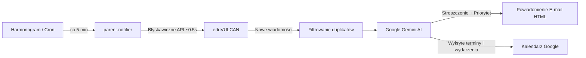

# 🔔 parent-notifier

> **Inteligentny, prywatny asystent i centrum powiadomień dla rodziców uczniów.**  
> Automatyzuje pobieranie wiadomości z dzienników elektronicznych, filtruje szum informacyjny z pomocą AI, wysyła czytelne zestawienia e-mail oraz synchronizuje zebrania i wycieczki z Kalendarzem Google.

[](https://github.com/macxq/parent-notifier/actions/workflows/ci.yml)
[](https://github.com/macxq/parent-notifier/actions/workflows/docker-build.yml)


---

## 📌 O projekcie

Codzienność rodzica w polskiej szkole to nieustanne logowanie się do dziennika elektronicznego, przedzieranie się przez dziesiątki ogłoszeń organizacyjnych i stres, że w gąszczu wiadomości umknie kluczowa informacja: zebranie z wychowawcą, konieczność podpisania zgody, wycieczka klasowa czy płatność za obiady.

**`parent-notifier`** powstał jako niezależne, otwartoźródłowe narzędzie, które działa w tle (np. na domowym serwerze, NAS czy Raspberry Pi) i dba o to, abyś zawsze wiedział o najważniejszych sprawach:

1. **Wielu uczniów w jednym miejscu** – automatycznie pobiera i porządkuje wiadomości dla wszystkich Twoich dzieci (nawet z różnych szkół/klas).
2. **Błyskawiczne działanie (~0.5s)** – po wstępnej autoryzacji korzysta z bezpiecznego cache'a sesji SSO, dzięki czemu nie obciąża serwerów szkolnych ani Twojego łącza.
3. **Analiza AI (Google Gemini Flash)** – sztuczna inteligencja analizuje treść każdej wiadomości, ocenia jej wagę (`[📌 WAŻNE]`), generuje zwięzłą notatkę *"Co rodzic musi wiedzieć"* i wyciąga daty planowanych wydarzeń.
4. **Kalendarz Google z powiadomieniami** – wykryte zebrania, wycieczki i dni wolne automatycznie trafiają do Twojego Kalendarza Google z przypomnieniem (dzwoneczek na telefonie 1 lub 2 dni wcześniej).
5. **Eleganckie powiadomienia e-mail** – otrzymujesz przejrzysty raport HTML/tekstowy na swoją skrzynkę (np. Gmail) od razu po pojawieniu się nowej wiadomości.
6. **100% prywatności (Self-Hosted)** – żadne hasła, dane uczniów ani treści wiadomości nie opuszczają Twojego własnego urządzenia.

---

## 🗺️ Wizja i Roadmapa

Projekt został zaprojektowany modularnie z myślą o unifikacji powiadomień ze wszystkich popularnych systemów szkolnych w Polsce:

- [x] **eduVULCAN** – pełne wsparcie dla kont rodziców z obsługą wielu dzieci, sesją SSO i automatycznym odświeżaniem tokenów.
- [ ] **Lokalny panel zarządzania (Web UI)** – wbudowany lekki interfejs w przeglądarce:
  - **Google OAuth2 (Authorization Code Flow)** – autoryzacja konta Google jednym kliknięciem:
    - Bezpośrednie, natywne powiadomienia dzwoneczkiem na smartfonie rodzica (bez ograniczeń kont usług).
    - Wybór docelowego kalendarza z listy rozwijanej zamiast wpisywania technicznych ID.
  - **Kreator konfiguracji** – prosta konfiguracja `.env`, test wysyłki e-mail i test klucza Google Gemini z poziomu przeglądarki.
  - **Dashboard wiadomości** – podgląd odebranych wiadomości, statusu synchronizacji i logów na żywo.
- [ ] **Librus Synergia** – modułowe wsparcie dla kolejnego popularnego dziennika elektronicznego w Polsce.
- [ ] **Dodatkowe kanały powiadomień** – integracja z Telegram Botem, Discord Webhooks oraz Gotify / ntfy.

---

## 🏗️ Jak to działa pod maską?



1. **Scheduler** budzi skrypt w zdefiniowanych godzinach (domyślnie 7:00–22:00 co 5 minut; pauza w nocy).
2. Skrypt sprawdza skrzynkę za pomocą zapamiętanej sesji Playwright. Jeśli sesja wygaśnie (np. kod 409), w tle automatycznie wykonuje ciche odświeżenie logowania.
3. Nowe, nieprzetworzone wiadomości trafiają do modelu **Gemini Flash**, który w ułamku sekundy klasyfikuje treść.
4. Jeśli wiadomość zawiera termin przyszły (np. *"W czwartek 12.10 wyjście do teatru"*), wpis z opisem i przypomnieniem ląduje w Twoim Kalendarzu Google.
5. Na Twój adres e-mail wysyłany jest estetyczny e-mail z podsumowaniem i pełną treścią.

---

## 📋 Wymagania

- **Docker & Docker Compose** (rekomendowane: Raspberry Pi 4/5, domowy mini-PC, serwer x86/ARM, NAS Synology/QNAP)  
  *lub Python 3.10+ w przypadku uruchamiania bezpośrednio w systemie.*
- Konto rodzica w systemie **eduVULCAN**.
- *(Zalecane)* Bezpłatny klucz API do **Google Gemini** (z [Google AI Studio](https://aistudio.google.com/)).
- *(Zalecane)* Poczta Gmail z wygenerowanym [Hasłem do aplikacji](https://myaccount.google.com/apppasswords) (do wysyłki SMTP).
- *(Opcjonalne)* Konto usługi Google Cloud (Service Account) z włączonym Google Calendar API (do synchronizacji z kalendarzem).

---

## 🚀 Szybki start (Docker)

### 1. Sklonuj repozytorium
```bash
git clone https://github.com/macxq/parent-notifier.git
cd parent-notifier
```

### 2. Skonfiguruj plik `.env`
Skopiuj szablon i uzupełnij swoje dane:
```bash
cp .env.example .env
nano .env
```

Zawartość pliku `.env`:
```ini
# --- Logowanie do eduVULCAN ---
VULCAN_USER=twoj_login_lub_email@domena.pl
VULCAN_PASSWORD=twoje_haslo_do_vulcana

# --- Wysyłka e-mail (Gmail SMTP) ---
SMTP_USER=twoj_email@gmail.com
SMTP_PASSWORD=xxxx xxxx xxxx xxxx          # 16-znakowe hasło aplikacji Google
EMAIL_TO=mama@gmail.com,tata@gmail.com     # Adresaci powiadomień (po przecinku)

# --- Analiza AI (Google Gemini Flash) ---
GEMINI_API_KEY=AIzaSy...                   # Darmowy klucz z aistudio.google.com

# --- (Opcjonalnie) Kalendarz Google ---
GOOGLE_CALENDAR_ID=c_xxxx@group.calendar.google.com
GOOGLE_SERVICE_ACCOUNT_FILE=data/service_account.json
```

### 3. Zbuduj i uruchom kontener
Docker automatycznie utworzy lokalny katalog `data/` i będzie w nim przechowywać stan sesji oraz historię powiadomień:
```bash
docker compose up -d --build
```

### 4. Sprawdź logi
```bash
docker logs -f parent_notifier
```
Przy pierwszym uruchomieniu Playwright przeprowadzi pełne logowanie, zapisze stan sesji w `data/storage_state.json`, po czym kolejne sprawdzenia będą realizowane błyskawicznie w tle co 5 minut.

---

## ⚙️ Przewodnik konfiguracji integracji

### 📧 1. Powiadomienia E-mail (Gmail)
Dla bezpieczeństwa Google wymaga tzw. **Hasła do aplikacji** zamiast głównego hasła do konta:
1. Wejdź na [myaccount.google.com](https://myaccount.google.com/) i włącz weryfikację dwuetapową (2-Step Verification).
2. Przejdź do: [Bezpieczeństwo -> Hasła do aplikacji](https://myaccount.google.com/apppasswords).
3. Wpisz nazwę aplikacji (np. `parent-notifier`) i kliknij **Utwórz**.
4. Wygenerowane 16-znakowe hasło wpisz w zmiennej `SMTP_PASSWORD` w `.env`.

### 🤖 2. Inteligentna analiza AI (Google Gemini)
1. Zaloguj się na [Google AI Studio](https://aistudio.google.com/).
2. Kliknij **Get API key** -> **Create API key**.
3. Wklej wygenerowany klucz jako `GEMINI_API_KEY` w pliku `.env`.  
   *Pakiet bezpłatny (Free Tier) w zupełności wystarcza do setek zapytań dziennie.*

### 📅 3. Kalendarz Google (Automatyczne wydarzenia)
Integracja wykorzystuje oficjalne Google Calendar API za pośrednictwem Konta Usługi (Google Service Account):

1. **Projekt Google Cloud**:
   - Przejdź do [Google Cloud Console](https://console.cloud.google.com/).
   - Utwórz nowy projekt (np. `School Assistant`).
   - W sekcji **APIs & Services -> Library** wyszukaj **Google Calendar API** i kliknij **Enable**.
2. **Konto usługi (Service Account)**:
   - W sekcji **APIs & Services -> Credentials** kliknij **Create Credentials -> Service Account**.
   - Nazwij konto (np. `parent-notifier`) i zakończ kreator.
   - Kliknij utworzone konto usługi, przejdź do zakładki **Keys -> Add Key -> Create new key -> JSON**.
   - Pobrany plik zapisz w katalogu `data/` pod nazwą `service_account.json` (tj. `data/service_account.json`).
3. **Udostępnienie kalendarza**:
   - Skopiuj adres e-mail konta usługi (np. `parent-notifier@twoj-projekt.iam.gserviceaccount.com`).
   - Otwórz [Kalendarz Google](https://calendar.google.com/).
   - W ustawieniach wybranego kalendarza (lub utwórz dedykowany kalendarz, np. *"Szkoła Dzieci"*), przejdź do sekcji **Udostępnij określonym osobom lub grupom**.
   - Dodaj adres konta usługi z uprawnieniem: **Wprowadzanie zmian w wydarzeniach**.
   - W sekcji **Integracja kalendarza** skopiuj **Identyfikator kalendarza** (np. `c_xxxx@group.calendar.google.com`) i wklej go do `GOOGLE_CALENDAR_ID` w pliku `.env`.

> [!TIP]
> **Powiadomienia na telefonie dla wydarzeń kalendarza:**  
> Google Calendar API tworzy wydarzenia całodniowe w imieniu konta usługi. Aby otrzymywać głośne przypomnienia (powiadomienia dzwoneczkiem) na telefonie, wejdź w ustawienia tego kalendarza w przeglądarce ([calendar.google.com](https://calendar.google.com/)) -> sekcja **Powiadomienia o wydarzeniach całodniowych** -> dodaj powiadomienie (np. *"1 dzień wcześniej o 09:00"* lub *"W dniu wydarzenia o 07:30"*). Każdy domownik mający dostęp do tego kalendarza otrzyma natywne powiadomienie na swój smartfon!

---

## 🛠️ Narzędzia diagnostyczne i CLI

Możesz w każdej chwili wywołać skrypt z poziomu kontenera (lub lokalnie), aby przetestować konfigurację lub podejrzeć wiadomości bez wysyłania e-maili:

```bash
# Test połączenia i uprawnień do Kalendarza Google
docker exec -it parent_notifier python3 vulcan_messages.py --test-calendar

# Podgląd N ostatnich wiadomości w terminalu (bez wysyłki e-maili)
docker exec -it parent_notifier python3 vulcan_messages.py --last 5 --no-email

# Podgląd wyłącznie wiadomości nieprzeczytanych w eduVULCAN
docker exec -it parent_notifier python3 vulcan_messages.py --unread

# Wyczyszczenie pamięci dodanych wydarzeń kalendarza (pozwala przetestować ponowne dodanie)
docker exec -it parent_notifier python3 vulcan_messages.py --reset-calendar

# Reset bazy odebranych wiadomości (skrypt pobierze najnowsze ponownie jako nowe)
docker exec -it parent_notifier python3 vulcan_messages.py --reset
```

---

## 🧪 Testy jednostkowe i Jakość kodu (CI)

Projekt zawiera wbudowany zestaw testów jednostkowych weryfikujących logikę czyszczenia treści HTML, obsługę pamięci podręcznej i wolumenów, formatowanie terminów kalendarza oraz zachowanie AI:

```bash
# Uruchomienie testów lokalnie (standardowy Python):
python3 -m unittest discover tests

# Lub za pomocą Pytest (po zainstalowaniu requirements-dev.txt):
pytest tests/ -v

# Sprawdzenie jakości kodu z Pylint:
pylint --rcfile=.pylintrc vulcan_messages.py scheduler.py tests/
```

W repozytorium skonfigurowane są akcje **GitHub Actions**:
- **CI**: automatyczne uruchamianie `pylint` oraz `pytest` przy każdym commicie i Pull Requeście.
- **Docker Build**: automatyczna weryfikacja budowania obrazu Docker i test uruchomieniowy (*smoke test*).

---

## 🔒 Bezpieczeństwo i Prywatność (RODO / Self-Hosted)

Projekt został zaprojektowany z myślą o pełnej przejrzystości i ochronie prywatności rodziny:

- **Architektura 100% Self-Hosted**: Narzędzie działa wyłącznie na Twoim własnym urządzeniu (Raspberry Pi, serwer domowy, PC). Projekt nie posiada żadnego zewnętrznego backendu, serwera pośredniczącego ani telemetrii. Twórca oprogramowania nie ma wglądu w żadne Twoje dane.
- **Bezpośrednia komunikacja**: Wszystkie zapytania wychodzą bezpośrednio z Twojego urządzenia do oficjalnych serwerów eduVULCAN (`eduvulcan.pl`) oraz Google (`googleapis.com`) szyfrowanym protokołem HTTPS/TLS.
- **Ochrona poświadczeń**: Hasła, loginy i tokeny sesji pozostają w plikach `.env` i `data/` na Twojej maszynie — są w pełni ignorowane przez `.gitignore` i nigdy nie trafiają do repozytorium.

### 🤖 Przetwarzanie danych przez sztuczną inteligencję (Google Gemini)
- **AI jest w 100% opcjonalne**: Jeśli nie chcesz, aby treść wiadomości była analizowana przez model językowy, po prostu pozostaw pole `GEMINI_API_KEY=` puste w `.env`. Skrypt będzie normalnie pobierał wiadomości i wysyłał powiadomienia e-mail w formie klasycznej.
- **Co trafia do API AI?**: Gdy klucz API jest podany, do Google Gemini przesyłany jest wyłącznie **temat oraz treść ogłoszenia** w celu wygenerowania jednozdaniowego streszczenia i wyodrębnienia dat do kalendarza.
- **Czego AI NIE otrzymuje?**: Do modelu **nigdy nie są wysyłane** Twoje dane logowania, hasła, numery PESEL, numery kont bankowych rodziców ani tokeny dostępowe.
- **Bezpośrednie zapytanie**: Treść trafia bezpośrednio z Twojego kontenera do oficjalnego API Google (`generativelanguage.googleapis.com`) na Twoim własnym, prywatnym kluczu deweloperskim. Dane podlegają [Warunkom korzystania z interfejsów API Google](https://ai.google.dev/terms).

---

## ⚖️ Nota prawna i Zastrzeżenia (Legal Disclaimer)

1. **Projekt niezależny**: Niniejsze oprogramowanie jest niezależnym projektem open-source o charakterze hobbystycznym i edukacyjnym. Projekt **nie jest** w żaden sposób powiązany, sponsorowany, autoryzowany ani wspierany przez VULCAN Sp. z o.o., Librus Sp. z o.o., Google LLC, Ministerstwo Edukacji Narodowej ani jakikolwiek inny podmiot trzeci.
2. **Znaki towarowe**: Wszelkie nazwy produktów, logotypy, znaki towarowe i zarejestrowane znaki handlowe (w tym m.in. *eduVULCAN*, *VULCAN*, *Librus*) należą do ich prawnych właścicieli. Zostały użyte w niniejszym projekcie wyłącznie w celach informacyjnych, referencyjnych i identyfikacyjnych, w granicach dozwolonego użytku (zgodnie z art. 156 ustawy z dnia 30 czerwca 2000 r. – Prawo własności przemysłowej).
3. **Brak konkurencji handlowej**: Oprogramowanie nie jest produktem komercyjnym, nie stanowi usługi SaaS i nie stanowi konkurencji dla oficjalnych aplikacji mobilnych czy serwisów internetowych. Stanowi ono prywatny skrypt asystujący (ang. *interoperability & personal productivity tool*), działający wyłącznie na urządzeniu użytkownika i realizujący operacje w imieniu zalogowanego rodzica przy użyciu jego własnych danych uwierzytelniających.
4. **Brak omijania zabezpieczeń**: Oprogramowanie nie modyfikuje baz danych, nie omija mechanizmów uwierzytelniania ani nie narusza integralności systemów oświatowych. Działa jak standardowa przeglądarka internetowa pobierająca dane dostępne dla rodzica.
5. **Wyłączenie odpowiedzialności (AS IS)**: Oprogramowanie jest dostarczane w stanie, w jakim się znajduje („tak jak jest” / *AS IS*), na warunkach licencji MIT, bez jakichkolwiek gwarancji, wyraźnych lub dorozumianych. Autor nie ponosi żadnej odpowiedzialności za jakiekolwiek bezpośrednie lub pośrednie skutki korzystania z oprogramowania, w tym za błędy w powiadomieniach, niedostarczenie wiadomości czy zmiany w API dostawców dzienników.

---

## 📄 Licencja

Projekt dystrybuowany jest na licencji **MIT**. Szczegółowe informacje znajdują się w pliku [LICENSE](file:///Users/maciek/dev/edu-vulcan/LICENSE).
